# GHOST LINE

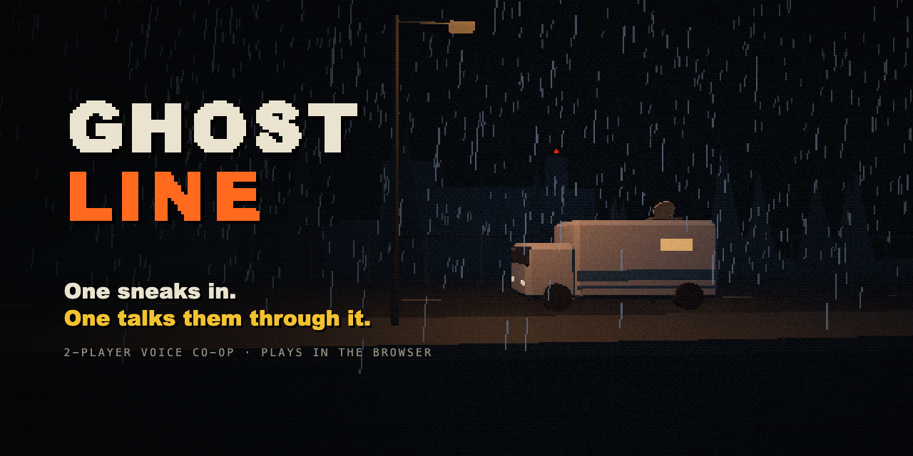

**Play: https://us.pinkstrokes.com**

A two-player voice co-op infiltration game. One player is **GHOST**, sneaking through the abandoned secret facility KESTREL-9 in first person. The other is **LINE**, sitting in a surveillance van (also in first person) with the facility blueprints, tapped CCTV cameras, a terminal patched into the building's control system and a paper cipher wheel.

GHOST can see every detail of the security systems but doesn't know how to beat them. LINE knows how, and can see what GHOST can't (infra-red lasers, light beams, thermal imaging, motion sensors), but can't move. You have to talk your way through every zone.

Design document (Chinese): [docs/DESIGN.md](docs/DESIGN.md)

| | |
|---|---|
| 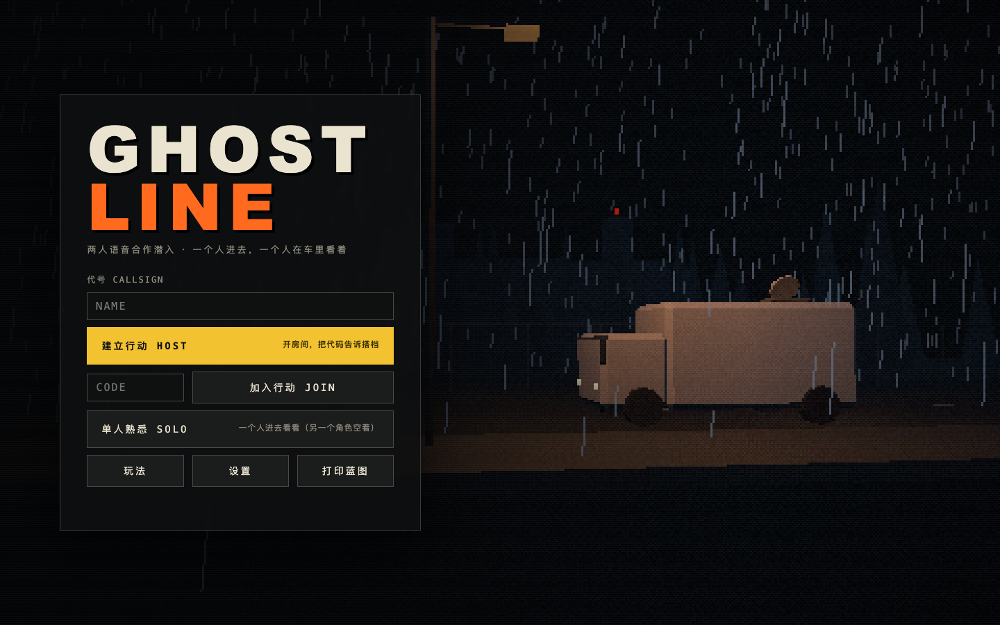 | 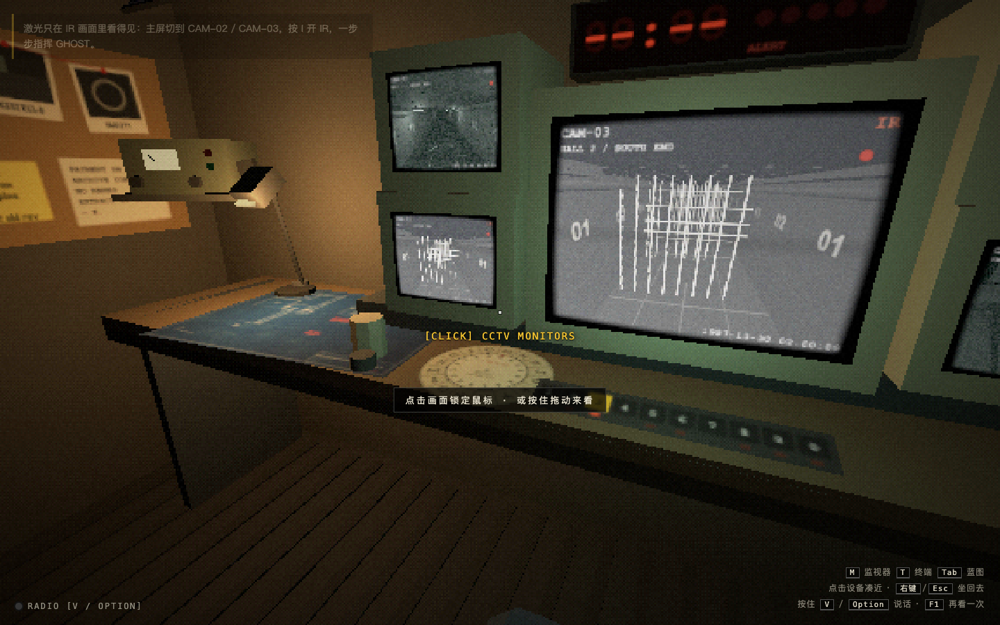 |
| 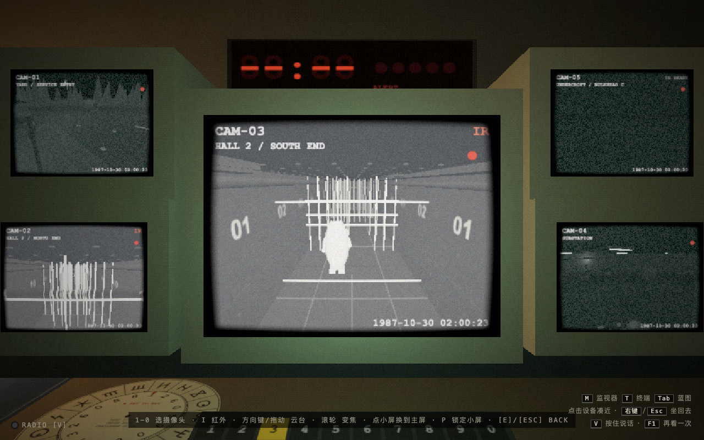 | 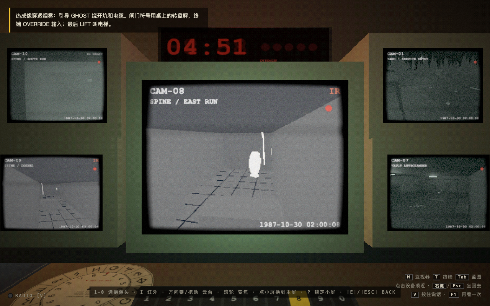 |
| 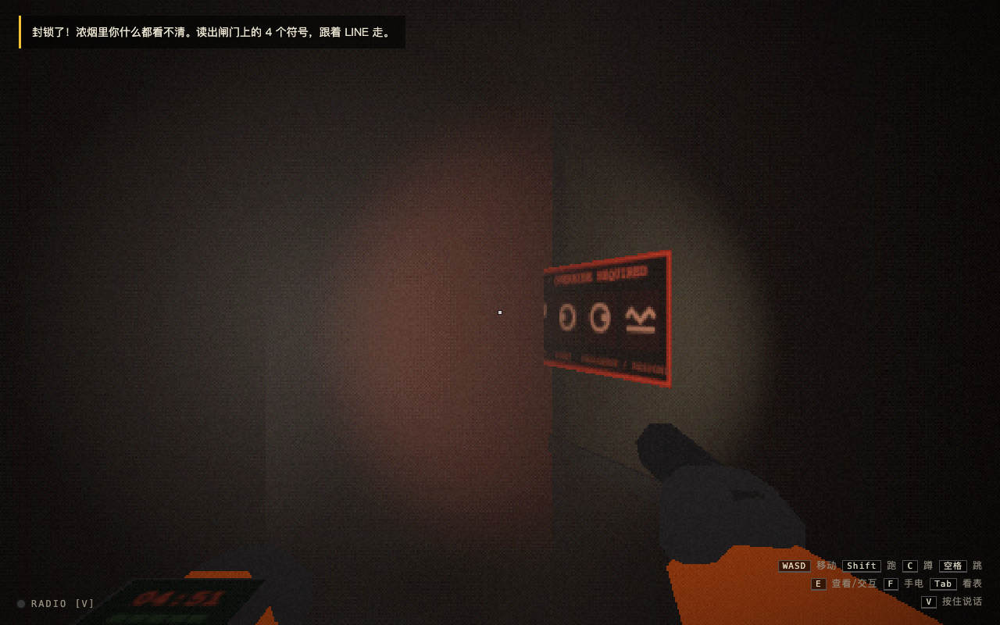 | 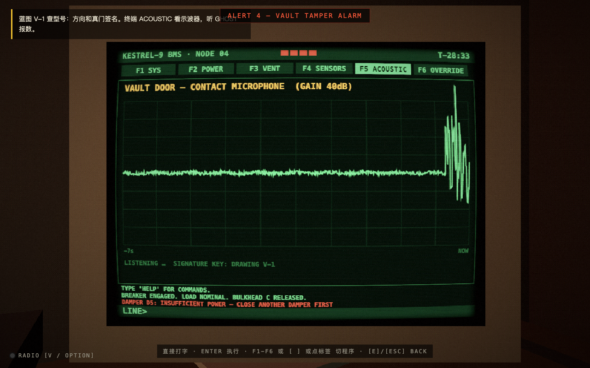 |
| 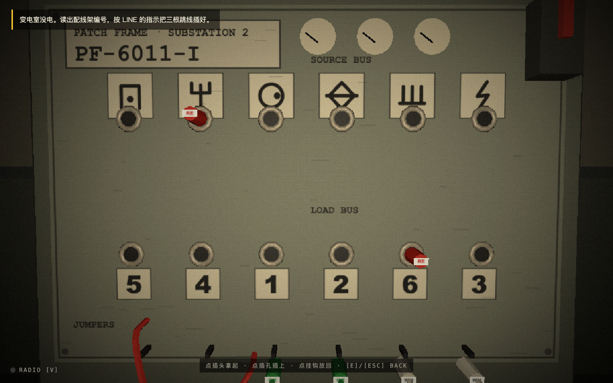 | 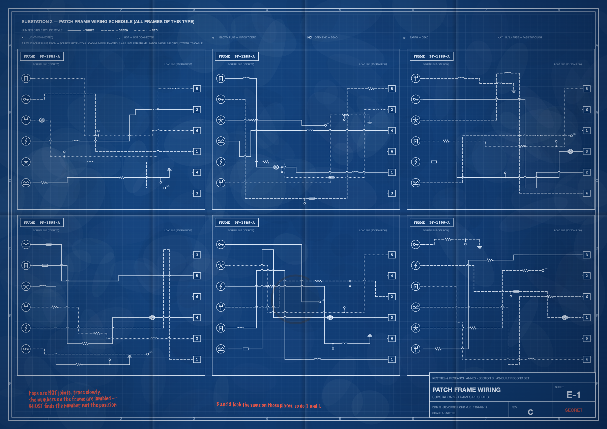 |
| 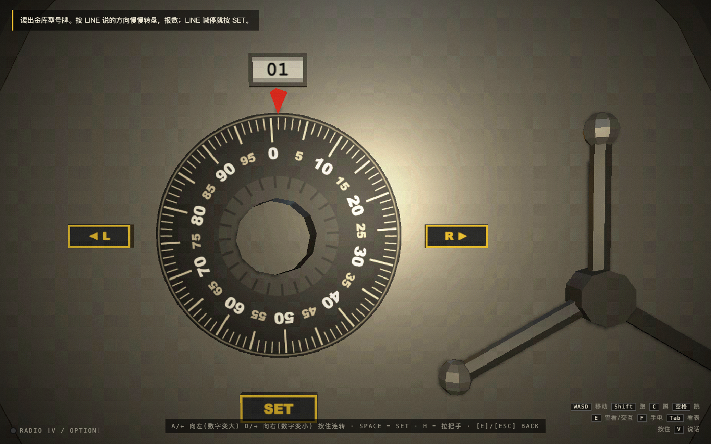 | 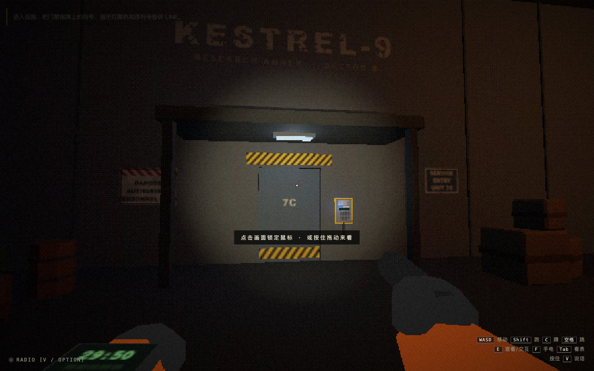 |

## Play online

https://us.pinkstrokes.com (Hetzner, Caddy reverse proxy plus a self-hosted coturn relay, so in-game voice works across the internet). After changing the code, redeploy with `scripts/deploy.sh`.

## Run it yourself

Requires Node.js 20+.

```bash
npm install
npm start
```

The server prints two addresses:

- This machine: `http://localhost:8080`
- Another computer on your LAN: `https://<your-LAN-IP>:8443` (self-signed certificate: accept the warning once. Browsers only allow the microphone over https.)

Only one computer needs to run the server. The self-signed certificate is generated with the system `openssl`; on Windows without openssl, https is disabled, so in-game voice won't work for the LAN partner. Use Discord instead; the game itself still connects.

One player clicks **HOST OPERATION** and gives the 4-letter operation code to their partner, who types it in and clicks **JOIN**. Pick roles (GHOST / LINE; **SWAP SEATS** switches them), both click **READY**, then **START OPERATION**. Two browser windows on the same computer work too, for testing or to learn both sides.

In-game radio: hold **V** to talk (LINE can also hold Option/Alt, which keeps working while typing in the terminal). **SETTINGS** can switch to an open mic, or turn in-game voice off so you can use Discord or sit in the same room. **RADIO CHECK** in the lobby tests your mic. Voice is WebRTC (the online version has its own TURN relay). Note: with in-game voice, the creature in Z4/Z7 can hear the radio. That's part of the game; on Discord it can't.

Paper blueprints: the lobby has a "print this mission's blueprints" link (`/blueprint.html?seed=…`, also reachable from **PRINT BLUEPRINTS** on the title screen), with an ink-saver option for white paper. Blueprints change with every seed, so an old printout won't match a new mission.

## Controls

**GHOST**: WASD move · mouse look · Shift run (loud) · C crouch (quiet) · Space jump · F torch · E inspect / use (mirrors: E clockwise, Q anticlockwise) · Tab raise your watch · V talk

**LINE**: mouse look · click a station to lean in · right-click / Esc sit back · M monitors · T terminal · Tab blueprints · V talk
- Monitors: 1–0 pick a camera, I infra-red / thermal, arrows or drag to pan and tilt, wheel to zoom, click a side screen to swap it to the main one, P pins the side screens
- Blueprints: drag to pan, wheel to zoom, Shift+drag red pencil, Z undo, X clear this sheet, F fit, 1–7 change sheet (00 cover / A-1 site / A-2 access / E-1 patch frame / M-1 undercroft / O-1 optics / V-1 vault)
- Terminal: just type (HELP lists commands); F1–F6, `[` `]` or click a tab to switch programs
- Cipher wheel: drag or ←/→ to turn the inner disc

## The seven zones

| | GHOST | LINE |
|---|---|---|
| Z1 Gatehouse | Describes the 3 symbols and the lamp colour on the access plate; works out the 4th digit from the SOP sheet in the guard booth | Looks up the first 3 digits in the code table on A-2 (watch out for the void REV A) |
| Z2 Laser Hall | Can't see the lasers; follows directions (lanes A–D, row numbers, crouch, jump) | IR cameras show the beams and their blink / sweep timing |
| Z3 Substation | Reads the frame number, patches three jumper cables | Finds the matching diagram on E-1 and traces it; closes the breaker in the terminal |
| Z4 Undercroft | Pitch-dark maze: reads junction codes, avoids the creature (it hears the radio) | Map M-1, opens/closes dampers in the terminal (max 2 at once), watches the motion sensors |
| Z5 Optics Lab | Reports which two wall ports have a blinking lamp, turns mirrors | Ceiling IR camera shows the beam; light both receivers at once |
| Z6 Vault | Reads the model plate, calls out numbers where the dial drags, presses SET | V-1 gives wheel directions and the true-gate signature; watches the acoustic scope |
| Z7 Escape | Almost blind in the smoke, reads bulkhead symbols, something is following | Thermal cameras guide GHOST and track the creature; the cipher wheel opens each bulkhead; calls the lift |

A mistake raises the alert level (the first wrong gate code is only a warning). Max out the alert level, or run out of time, and the mission fails. Each zone has a par time, shown as ahead/behind on GHOST's watch, LINE's terminal and the end screen. Three difficulties: RECRUIT / OPERATIVE / GHOST. The lobby can also start a single zone for practice.

## What was challenging

- **Every puzzle needs both players.** Each zone splits the information: GHOST sees the hardware, LINE has the drawings, cameras and terminal. Blueprints, codes, wiring, the maze and the vault are generated from a seed, so answers cannot be memorised. `npm run verify` solves 2,000 seeds to check that every zone is solvable together and that neither side can finish it alone.
- **Reading a laser grid through a camera.** Seven gates stacked up in perspective on the CCTV feed and looked like one white mesh. Now only the gate just ahead of GHOST glows on infra-red (GHOST's torch carries IR); the rest are dim outlines.
- **Voice across the internet.** At first every call went through the TURN relay in Oregon, which added delay. Calls now try a direct connection first and fall back to the relay, and the lobby and HUD show which route is in use (LAN / DIRECT / RELAY).
- **Frame pacing.** On 120 Hz screens the uncapped loop swung between 120 and 30 fps. The fix was a 60 fps cap, repainting the wristwatch texture only when it changes, and updating the 3D audio listener at 30 Hz instead of every frame.
- **A fair monster.** The first version of the creature in the escape corridor walked toward GHOST's real position, so a silent, still player was caught in 11–21 s. It now only follows sounds it hears, and a script measures time-to-catch for silent, crouching, talking and loud-radio cases (40 runs each).

## What was fun

- The creature hears the radio. LINE's voice comes out of GHOST's walkie-talkie, so the person in the van has to whisper the answers.
- Watching your partner fail on camera: a strike knocks GHOST over and LINE's main monitor cuts to that zone's camera.
- Drawing the blueprints entirely in code, down to the coffee rings, the void stamp on the old code table and the handwritten notes in the margins.

## What I learned

- Automated play-throughs pass while real people still get stuck. Headless tests missed the pause menu, double-clicks and reconnects (an independent review found 13 bugs), and the first human playtest found seven more: GHOST faced backwards on the cameras, the held plug blocked its own mouse ray, Tab locked the mouse, and nobody could map the vault's scope signatures to dial numbers.
- Information has to flow both ways. Zones where only LINE talks feel like dictation, so GHOST now also holds things LINE cannot see (the check-digit sheet in the guard booth, the blinking receiver lamps, the drag of the vault dial).
- Measure before tuning. Frame-time traces, not guesses, showed the stutter came from texture uploads and audio automation, not game logic (about 1.5 ms per frame).

## Next steps

- **Several teams in one facility.** Two to four LINE + GHOST teams enter from different sides and race for the single archive core, with one shared creature, one shared alarm and radios the other teams can tune into.
- **Same-seed races.** Every team plays the same seed, with a live progress board and a daily leaderboard.
- **Three-player squads.** One LINE handling two GHOSTs, with puzzles that need two people in two places at once (a two-dial vault, luring the creature away).
- **Replay variety.** One or two seeded complications per run, such as a dead camera or a painted-over model plate.
- More playtests on the LINE side: the laser hall's length and the cost of rendering several CCTV feeds.

## Development

```bash
npm run dev        # Vite (5233) + websocket server (8091)
npm run verify     # seeds: every zone is solvable + a full scripted mission runs through
node scripts/e2e.mjs http://localhost:5233 /tmp/gl-e2e   # two headless browsers play from lobby to extraction (needs npm run dev)
node scripts/sheets.mjs SEED /tmp/sheets                  # export the 7 blueprint sheets as PNGs (BASE=http://localhost:8080 to point elsewhere)
node scripts/qa-new.mjs http://localhost:8080 /tmp/gl-qa  # screenshots of the newer mechanics
```

Layout: `shared/` is pure logic used by both server and browser (mission generation, the room state machine, the optics simulation); `server/` serves static files and the websocket; `src/facility` is the facility and GHOST's view; `src/zones` the seven zones; `src/van` the van, CCTV, terminal and blueprint viewer; `src/blueprint` draws the blueprints. Every model, texture and sound is generated in code: no asset files, no external APIs.
